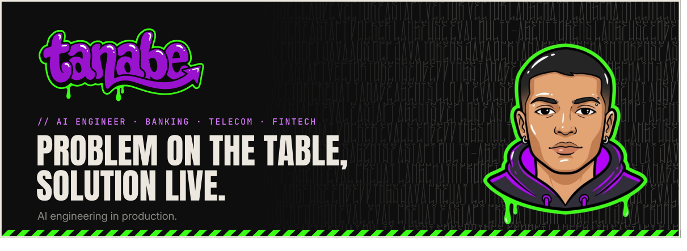

<a href="https://github.com/BrunoTanabe"><picture><source media="(prefers-color-scheme: dark)" srcset="https://brunotanabe.github.io/tanabe-stats/cards/button-github-dark.svg"></picture></a> <a href="https://www.linkedin.com/in/tanabebruno/"><picture><source media="(prefers-color-scheme: dark)" srcset="https://brunotanabe.github.io/tanabe-stats/cards/button-linkedin-dark.svg"></picture></a> <a href="https://medium.com/@tanabebruno"><picture><source media="(prefers-color-scheme: dark)" srcset="https://brunotanabe.github.io/tanabe-stats/cards/button-medium-dark.svg"></picture></a> <a href="mailto:tanabebruno@gmail.com"><picture><source media="(prefers-color-scheme: dark)" srcset="https://brunotanabe.github.io/tanabe-stats/cards/button-email-dark.svg"></picture></a>

Hi, I'm **Bruno**, an AI and backend engineer. Since 2023 I've been shipping **agents, RAG and automations** to production in banking, telecom and fintech, from scoping the problem to monitoring it in production.

<picture>
  <source media="(prefers-color-scheme: dark)" srcset="assets/h-numbers.svg">
  
</picture>

<a href="https://github.com/BrunoTanabe"><picture><source media="(prefers-color-scheme: dark)" srcset="https://brunotanabe.github.io/tanabe-stats/cards/hero-dark.svg"></picture></a>

<a href="https://github.com/BrunoTanabe"><picture><source media="(prefers-color-scheme: dark)" srcset="https://brunotanabe.github.io/tanabe-stats/cards/city-dark.svg"></picture></a>

<a href="https://github.com/BrunoTanabe"><picture><source media="(prefers-color-scheme: dark)" srcset="https://brunotanabe.github.io/tanabe-stats/cards/rhythm-dark.svg"></picture></a> <a href="https://github.com/BrunoTanabe?tab=repositories"><picture><source media="(prefers-color-scheme: dark)" srcset="https://brunotanabe.github.io/tanabe-stats/cards/languages-dark.svg"></picture></a>

<a href="https://github.com/pulls?q=is%3Apr+author%3ABrunoTanabe+is%3Amerged+-user%3ABrunoTanabe"><picture><source media="(prefers-color-scheme: dark)" srcset="https://brunotanabe.github.io/tanabe-stats/cards/open-source-dark.svg"></picture></a> <a href="https://github.com/BrunoTanabe?tab=repositories&sort=stargazers"><picture><source media="(prefers-color-scheme: dark)" srcset="https://brunotanabe.github.io/tanabe-stats/cards/most-starred-dark.svg"></picture></a>

<a href="https://medium.com/@tanabebruno"><picture><source media="(prefers-color-scheme: dark)" srcset="https://brunotanabe.github.io/tanabe-stats/cards/writing-dark.svg"></picture></a>

<picture><source media="(prefers-color-scheme: dark)" srcset="https://brunotanabe.github.io/tanabe-stats/cards/footer-dark.svg"></picture>

<picture>
  <source media="(prefers-color-scheme: dark)" srcset="assets/h-now.svg">
  
</picture>

- 🏦 **AI engineer at a major bank:** internal agents that automate code generation, Jira story writing and cost analysis, focused on answer quality and token savings.
- 📡 **AI engineer at a major telecom operator:** a multi-agent flow that runs technical support end to end: it diagnoses, fixes or schedules a technician, and warns about outages in the area.
- 🎓 Information Systems at **UNIFEI**.

<picture>
  <source media="(prefers-color-scheme: dark)" srcset="assets/h-stack.svg">
  
</picture>

<code>AI</code> 
      

<code>BACKEND</code> 
     

<code>INFRA</code> 
   

<code>FRONT</code> 
  

<picture>
  <source media="(prefers-color-scheme: dark)" srcset="assets/h-highlights.svg">
  
</picture>

| Project | What it is |
|---|---|
| [**fastapi-clean-architecture-ddd-template**](https://github.com/BrunoTanabe/fastapi-clean-architecture-ddd-template) | FastAPI template with Clean Architecture and DDD for AI backends. Docker, tests and well-defined layers. |
| [**curriculum-vitae-query-assistant**](https://github.com/BrunoTanabe/curriculum-vitae-query-assistant) | OCR + LLM that summarizes résumés and answers job-fit questions, without storing documents. |
| [**fastapi-nested-jwt-authentication**](https://github.com/BrunoTanabe/fastapi-nested-jwt-authentication) | Nested JWT authentication (JWS + JWE) in FastAPI, with rotation, revocation and HttpOnly cookies. |
| [**fastapi-api-key-authentication**](https://github.com/BrunoTanabe/fastapi-api-key-authentication) | API key authentication in FastAPI: header, query or cookie, scopes and tests. |
| [**multiple-ssh-keys-for-multiple-git-accounts**](https://github.com/BrunoTanabe/multiple-ssh-keys-for-multiple-git-accounts) | Guide to using several SSH keys and Git accounts on the same machine. |

<picture>
  <source media="(prefers-color-scheme: dark)" srcset="assets/h-journey.svg">
  
</picture>

| Period | Where | What |
|---|---|---|
| 2026 — now | Banking and telecom | AI engineer: internal agents and a multi-agent support flow |
| 2025 — 2026 | Teddy Open Finance | AI and backend engineer: B2B multi-agent system, AI engine with RAG, OCR, background check |
| 2024 — 2025 | GF Innovation | Full stack → AI tech lead: founded the AI team, anti-fraud, microservices |
| 2023 — 2024 | Tech4Humans | AI intern: multi-agent systems with RAG, document OCR (KYC), MLOps |

<picture>
  <source media="(prefers-color-scheme: dark)" srcset="assets/h-contact.svg">
  
</picture>

Got a problem AI should be solving and still isn't? **Let's talk.**

<a href="https://github.com/BrunoTanabe"><picture><source media="(prefers-color-scheme: dark)" srcset="https://brunotanabe.github.io/tanabe-stats/cards/button-github-dark.svg"></picture></a> <a href="https://www.linkedin.com/in/tanabebruno/"><picture><source media="(prefers-color-scheme: dark)" srcset="https://brunotanabe.github.io/tanabe-stats/cards/button-linkedin-dark.svg"></picture></a> <a href="https://medium.com/@tanabebruno"><picture><source media="(prefers-color-scheme: dark)" srcset="https://brunotanabe.github.io/tanabe-stats/cards/button-medium-dark.svg"></picture></a> <a href="mailto:tanabebruno@gmail.com"><picture><source media="(prefers-color-scheme: dark)" srcset="https://brunotanabe.github.io/tanabe-stats/cards/button-email-dark.svg"></picture></a>

<picture>
  <source media="(prefers-color-scheme: dark)" srcset="assets/footer.svg">
  
</picture>

